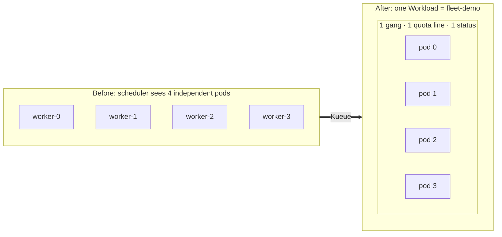
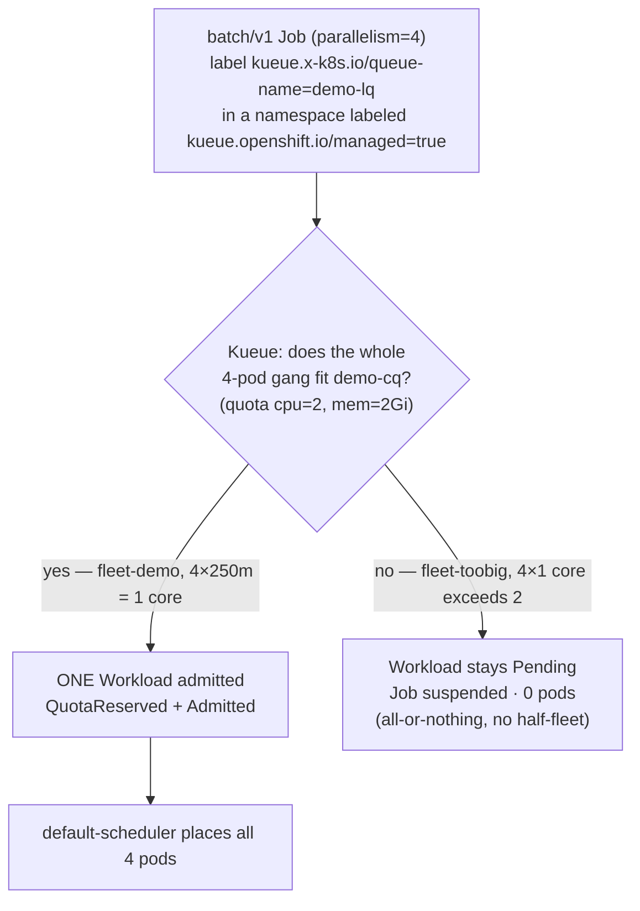
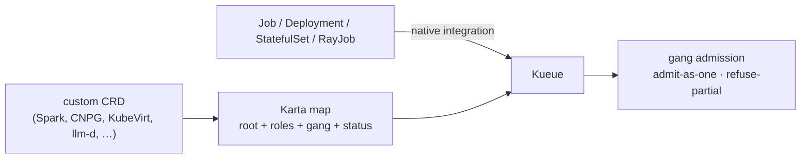

# kueue-karta-gang

Gang-admit a multi-pod workload as **one** logical unit on OpenShift — one identity, one quota
line, one all-or-nothing gang, one status — using the **Red Hat build of Kueue**, with
**[Karta](https://github.com/dsx-ai-factory/workload-map)** as the declarative bridge for the
custom CRDs Kueue doesn't natively integrate.

```bash
git clone https://github.com/RHEcosystemAppEng/kueue-karta-gang && cd kueue-karta-gang
```

---

## Quickstart

The demo needs only `oc` (as cluster-admin) and the **Red Hat build of Kueue** operator — no
GPU, no RHOAI, no custom scheduler. Install the operator (step 1 under [Prerequisites](#prerequisites)),
then:

```bash
oc apply -f examples/00-kueue-instance.yaml
oc wait --for=condition=Available kueue.kueue.openshift.io/cluster --timeout=180s
bash examples/test.sh      # creates the namespace + queues, runs both fleets, prints PASS
```

Expected tail:

```
PASS — Kueue gang-admits the fleet as ONE workload on the default-scheduler,
       and refuses to partially admit a fleet that doesn't fit (all-or-nothing).
```

`test.sh` creates/labels the namespace and applies the queues itself, so the one-command path
only needs the operator + instance CR in place first. For the step-by-step version, see
[Usage → Manual walkthrough](#manual-walkthrough).

---

## Overview

A core `batch/v1` **Indexed Job** with `parallelism: 4` is a multi-pod workload with **one
owner**. When its namespace is Kueue-managed and the Job carries the Kueue queue-name label,
Kueue admits all four pods as **one Workload** against **one ClusterQueue**, and the plain
OpenShift `default-scheduler` places them. A fleet that exceeds the quota stays **suspended with
zero pods** (all-or-nothing) — no stranded half-fleet holding resources.

That is the whole demo: no custom scheduler, no GPU, no framework. For a **custom CRD** Kueue
doesn't integrate out of the box, **Karta** supplies the same grouping declaratively (root
identity + roles + gang + status) for a gang-aware consumer to enforce — the maps under
`examples/` show the shape.

Verified on **OpenShift 4.x** with the **Red Hat build of Kueue v1.5.0**. (The verification
cluster also ran RHOAI 3.5.2, but nothing here depends on RHOAI — this is pure Kueue + a
`batch/v1` Job.)

### The idea, in one picture

The scheduler stops seeing four loose pods and starts seeing **one** workload — one gang, one
quota line, one status:



### What the demo does



---

## Repository layout

```
kueue-karta-gang/
├── README.md                          # this file (with inline Mermaid diagrams)
├── LICENSE                            # Apache-2.0
└── examples/
    ├── 00-kueue-instance.yaml         # Kueue instance CR: BatchJob integration + opt-in label policy
    ├── 01-kueue-queues.yaml           # quota layer: ResourceFlavor + ClusterQueue (demo-cq) + LocalQueue (demo-lq)
    ├── 02-example-job.yaml            # fleet-demo: 4×250m Job that FITS the 2-core quota  -> admitted
    ├── 03-gang-gated-job.yaml         # fleet-toobig: 4×1-core Job that EXCEEDS quota      -> suspended, 0 pods
    ├── karta-job-map.yaml             # Karta map for the core Job case (root = Job, gang key = job-name)
    ├── karta-template-agnostic.yaml   # parameterized Karta map (shapes A/B/C) for any framework
    ├── test.sh                        # one-shot: deploy, assert "4 pods -> 1 workload" + all-or-nothing, clean up, print PASS
    └── verify.sh                      # read-only inspector of an existing fleet
```

> **The demo namespace is pinned to `kueue-demo`.** `examples/01-kueue-queues.yaml` hardcodes
> `namespace: kueue-demo` for the `LocalQueue`, and the Job manifests reference it. If you rename
> the namespace, change it in `01-kueue-queues.yaml`, `02-example-job.yaml`, and
> `03-gang-gated-job.yaml` too (or pass `NS=<your-ns>` to `test.sh`/`verify.sh`), or admission
> silently breaks.

---

## Prerequisites

`oc` logged in as **cluster-admin** — installing the operator and creating
`ClusterQueue`/`ResourceFlavor` are cluster-scoped changes, so do them on a cluster you own or
with the platform team's go.

### 1. Install the Red Hat build of Kueue operator

Console → **OperatorHub** → *Red Hat build of Kueue* → channel `stable-v1.5` → **Install**
(installs cluster-wide into `openshift-kueue-operator`). A CLI install via a `Subscription` +
`OperatorGroup` in `openshift-kueue-operator` works too. Wait for the CSV to report `Succeeded`:

```bash
oc get csv -n openshift-kueue-operator
# NAME                    DISPLAY                  VERSION   RELEASE   REPLACES   PHASE
# kueue-operator.v1.5.0   Red Hat build of Kueue   1.5.0                          Succeeded
```

### 2. Create the Kueue instance CR

This cluster-singleton CR turns on the `batch/v1` Job integration and the **opt-in** label
policy. Once it is `Available=True`, the operator rolls out `kueue-controller-manager` and the
`kueue.x-k8s.io` CRDs appear.

```bash
oc apply -f examples/00-kueue-instance.yaml
oc wait --for=condition=Available kueue.kueue.openshift.io/cluster --timeout=180s
```

### 3. Create a managed namespace

The Red Hat build scopes its mutating webhook with the `kueue.openshift.io/managed=true` label,
so **unlabeled namespaces are never touched**. Miss this and your Job runs straight through the
default-scheduler with no Workload object — a silent no-op.

```bash
oc create namespace kueue-demo
oc label namespace kueue-demo kueue.openshift.io/managed=true
```

### 4. Create the queue layer

One `ResourceFlavor`, one `ClusterQueue` (`demo-cq`, quota `cpu=2, mem=2Gi`), and a `LocalQueue`
(`demo-lq`) in the namespace. Kueue objects use `apiVersion: kueue.x-k8s.io/v1beta2` (the storage
version).

```bash
oc apply -f examples/01-kueue-queues.yaml
oc wait --for=condition=Active clusterqueue/demo-cq --timeout=60s
```

> `test.sh` performs steps 3 and 4 itself, so for the one-command path you only need steps 1 and
> 2 (operator + instance CR) in place first.

---

## Usage

### One command

With the operator + instance CR in place (steps 1–2), `test.sh` creates/labels the namespace,
applies the queues, deploys both fleets, asserts the behavior, cleans up, and prints `PASS`:

```bash
oc login --token=... --server=https://api.<cluster>:6443   # replace with your own cluster
bash examples/test.sh
```

### Manual walkthrough

With all four prerequisites in place:

1. **Deploy the fleet that fits** — `oc apply -f examples/02-example-job.yaml`
   (`fleet-demo`: 4 pods × 250m = 1 core, fits the 2-core quota).
2. **See one Workload for the whole fleet** — `oc get workloads.kueue.x-k8s.io -n kueue-demo`.
   One `job-fleet-demo-<suffix>` Workload, `podSets[0].count = 4`, admitted by `demo-cq`.
   (Kueue's Job reconciler creates it a moment after the apply; re-run if the first `get` is empty.)
3. **Confirm it was admitted as a unit** — the Workload's `QuotaReserved`, `Admitted`, and
   `PodsReady` conditions are all `True` (order is nondeterministic).
4. **See the single quota line** — `oc get clusterqueue demo-cq`: `1` admitted workload, using
   `cpu 1 / mem 512Mi` of the `cpu=2, mem=2Gi` quota — not four pods fighting independently.
5. **See the pods on the stock scheduler** — `oc get pods -n kueue-demo -l job-name=fleet-demo`:
   four pods `Running`, each `schedulerName: default-scheduler`.
6. **Prove all-or-nothing** — `oc apply -f examples/03-gang-gated-job.yaml` (`fleet-toobig`:
   4 × 1 core > 2-core quota). Its Workload stays `QuotaReserved=False (Pending)`, the Job reports
   `suspend=true`, and `oc get pods -l job-name=fleet-toobig` returns **zero** pods.
7. **Clean up** — `oc delete job fleet-demo fleet-toobig -n kueue-demo`.

To see these commands with real sample output, run `examples/test.sh` (one-shot) or
`examples/verify.sh` against a live fleet; the full narrated walkthrough is in the published blog
post (link forthcoming).

---

## How it works

- **Opt-in, two labels.** The namespace carries `kueue.openshift.io/managed=true` and the Job
  carries `kueue.x-k8s.io/queue-name: demo-lq`. With `labelPolicy: QueueName`, Kueue manages only
  objects that carry the queue-name label, in only managed namespaces. Everything else is
  untouched — safe to enable on a shared cluster.
- **One owner → one Workload.** An Indexed Job is a single `batch/v1` object that owns all four
  pods. Kueue natively integrates `batch/v1 Job`, so it creates **one** Workload representing the
  whole 4-pod podSet and reserves quota for it against `demo-cq` as a unit.
- **All-or-nothing.** Quota is reserved for the full podSet or not at all. A fleet that doesn't
  fit keeps the Job suspended with zero pods created — no partial admission, no stranded
  half-fleet.
- **Kueue gates, the stock scheduler places.** Kueue controls *admission*; the plain OpenShift
  `default-scheduler` does *placement*. No scheduler swap required.
- **Where Karta fits.** Kueue natively groups `Job`, `Deployment`, `StatefulSet`, `RayJob`, and
  more. For a **custom CRD** none of them integrate, **Karta** is the declarative bridge: describe
  the workload once (root GVK + roles by component label + gang by group label + status), and a
  gang-aware consumer enforces the same admit-as-one / refuse-partial behavior. Identity must be a
  real root object (a CRD, or one builtin owner like a Job) — it can't be label-only.

> **The Karta maps in `examples/` are illustrative/reference templates.** They show the grouping
> *shape*; this repo does not include the registration tooling or a gang-aware consumer beyond
> Kueue's native Job integration. `karta-job-map.yaml` is the core-Job shape and
> `karta-template-agnostic.yaml` generalizes it (shapes A/B/C, with `<ROOT_GROUP>`/`<ROOT_VERSION>`/
> `<ROOT_KIND>` placeholders). See the [Karta project](https://github.com/dsx-ai-factory/workload-map)
> for the consumer side.

Two lanes reach the same gang-aware consumer — natively-integrated kinds go straight in; everything
else is described once with a Karta map:



---

## Verifying

`verify.sh` is a **read-only** inspector of an existing fleet (it creates and deletes nothing).
Because `test.sh` cleans up after itself, deploy a fleet first, then inspect it:

```bash
oc apply -f examples/02-example-job.yaml           # (prereqs 1–4 must be in place)
NS=kueue-demo NAME=fleet-demo bash examples/verify.sh
oc delete job fleet-demo -n kueue-demo             # when done
```

It prints the pods and their scheduler, the shared gang key (`batch.kubernetes.io/job-name`) on
every pod, the single Kueue Workload with its admission conditions, and the ClusterQueue usage.

---

## Cleanup

```bash
# Jobs (test.sh already removes these itself)
oc delete job fleet-demo fleet-toobig -n kueue-demo --ignore-not-found

# queue layer + namespace
oc delete -f examples/01-kueue-queues.yaml --ignore-not-found
oc delete namespace kueue-demo
```

The Kueue operator and instance CR are left in place — remove them
(`oc delete kueue.kueue.openshift.io/cluster`, then uninstall from OperatorHub) only if you also
want to uninstall Kueue entirely.

---

## FAQ / Notes

- **Why is opt-in a feature** The build only manages namespaces labeled
  `kueue.openshift.io/managed=true` and (with `labelPolicy: QueueName`) only Jobs carrying the
  queue-name label — so existing workloads on a shared cluster are never disturbed. The flip side:
  forget either label and admission silently no-ops (the Job runs through the default-scheduler
  with no Workload object).
- **Which Kueue API version?** Use `kueue.x-k8s.io/v1beta2` — the storage version. `v1beta1` still
  serves but `oc apply` emits a deprecation warning.
- **Why no `securityContext` in the Job manifests?** On OpenShift the `restricted-v2` SCC
  auto-applies a namespace UID, `runAsNonRoot`, `seccompProfile: RuntimeDefault`, and drops all
  capabilities. Pinning a fixed `runAsUser` (e.g. `1000`) **breaks** the pods — a UID outside the
  namespace's assigned range is rejected by the SCC. The manifests carry no `securityContext` by
  design, and `oc apply` emits no PodSecurity warning.
- **Do I need `waitForPodsReady`?** No. On this build the Workload reports `PodsReady=True (Started)`
  without it.
- **Why is the quota so small?** `demo-cq` is deliberately `cpu=2, mem=2Gi` so that `fleet-toobig`
  (4 × 1 core) visibly exceeds it and demonstrates gang-gating.

---

## References

- Karta (workload-map), Apache-2.0: <https://github.com/dsx-ai-factory/workload-map>
- Kubernetes Workload / PodGroup API this converges toward:
  [KEP-4671](https://github.com/kubernetes/enhancements/issues/4671),
  [KEP-6012](https://github.com/kubernetes/enhancements/issues/6012)

---

## License

[Apache-2.0](LICENSE).
